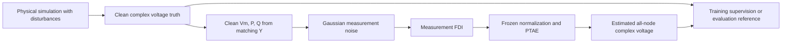

# Physics Transformer Autoencoder (PTAE)

**PTAE_Portable** estimates the physical voltage state of a distribution feeder from noisy sensor measurements that may also contain false data injection (FDI). The pretrained model receives voltage magnitude and active/reactive power at **1,173 sensor locations** and predicts **complex voltage at all 3,913 bus-phase nodes**.

The reference state is clean of added measurement noise and FDI. Real physical oscillation and imbalance disturbances remain in that state. PTAE estimates the state that actually occurred; it does not reverse physical disturbances or classify attacks. The pretrained model is tied to its original feeder, sensor installation, and measurement conventions.

## Quick start

1. Obtain the source archive or repository URL from its owner. Extract/clone the code into a folder named `PTAE_Portable`. No public source URL is assumed in these instructions.
2. Obtain the **pretrained deployment bundle separately**. No public model or dataset download link is configured. Extract the bundle so that `bundle.json` is directly inside `PTAE_Portable_assets/model/`.
3. Arrange the workspace as below. All model/data/output paths must be outside the code repository; names shown under assets other than `model/` describe separately supplied or locally generated files.

```text
workspace/
├── PTAE_Portable/              Code repository
│   ├── run.py
│   └── ...
├── PTAE_Portable_assets/       Distributed separately from the code
│   ├── model/
│   │   ├── bundle.json
│   │   ├── best_model.pth
│   │   ├── normalization.npz
│   │   ├── sensor_order.json
│   │   └── system/
│   ├── data/
│   ├── prepared/
│   ├── outputs/
│   └── runs/
└── ptae-venv/                  Local Python environment
```

4. From `workspace/`, install the tested Linux CPU environment:

```bash
cd PTAE_Portable
python3.11 -m venv ../ptae-venv
source ../ptae-venv/bin/activate
python -m pip install torch==2.10.0 --index-url https://download.pytorch.org/whl/cpu
python -m pip install -r requirements.txt
```

5. Verify the separately supplied model:

```bash
python run.py verify --model-dir ../PTAE_Portable_assets/model
```

6. Run automated software tests; these need **code and dependencies only**:

```bash
python -B -m unittest discover -s tests -v
```

7. Obtain compatible measurement arrays separately and follow [Running predictions](#running-predictions). Prediction examples require those files; they do not generate evaluation data.

`python run.py --help` works with code alone, even before numerical dependencies are installed. Run the remaining examples from the repository root with the environment activated, unless otherwise stated.

## Requirements

| Component | Requirement / validation status |
| --- | --- |
| Python | 3.11 or later is required by the code. **3.11.11 tested locally**; Python 3.12 is configured in CI but has not been executed locally. Other versions are unvalidated. |
| NumPy | Tested pin: **2.3.5**; declared range `>=1.26,<3`. |
| SciPy | Tested pin: **1.16.3**; declared range `>=1.11,<2`. |
| PyTorch | Tested pin: **2.10.0**, with CPU-only and CUDA 12.8 builds; declared range `>=2.6,<3`. |
| Execution | CPU is the default. CUDA is optional. The CLI supports `cpu`, `cuda`, and `auto`. |
| Platforms | Local execution validated on Linux. macOS and Windows commands are provided, but those platforms have not been run here. MPS/ROCm execution has not been validated. |

`requirements.txt` applies `constraints-tested.txt`, so the documented installation uses the tested numerical versions. Broader declared ranges are not a claim that every combination has been tested. Jupyter, pandas, plotting packages, and OpenDSS are not required for inference or retraining on prepared arrays.

No minimum RAM, GPU memory, or execution-time guarantee has been established. The checkpoint is about 21 MB; it is only one part of runtime memory use. Dataset storage and calibration scratch space are additional. Reduce `--batch-size` if necessary.

## Installation

The Linux CPU commands in [Quick start](#quick-start) create the external `ptae-venv` and install the pinned dependencies. Do not install the repository as a Python package; use `run.py` directly.

**macOS:** use the same environment/activation commands, then install from PyPI:

```bash
python -m pip install -r requirements.txt
```

**Windows PowerShell**, starting in `workspace/`:

```powershell
cd PTAE_Portable
py -3.11 -m venv ..\ptae-venv
& ..\ptae-venv\Scripts\Activate.ps1
python -m pip install torch==2.10.0 --index-url https://download.pytorch.org/whl/cpu
python -m pip install -r requirements.txt
python run.py verify --model-dir ..\PTAE_Portable_assets\model
python -B -m unittest discover -s tests -v
```

If local PowerShell policy prevents activation, invoke `..\ptae-venv\Scripts\python.exe` directly in place of `python`.

**Optional CUDA (Linux/Windows):** in a separate environment with a driver compatible with CUDA 12.8, install the matching build before the remaining requirements:

```bash
python -m pip install torch==2.10.0 --index-url https://download.pytorch.org/whl/cu128
python -m pip install -r requirements.txt
```

Choose builds for **2.10.0** using the [official PyTorch version-specific installation instructions](https://pytorch.org/get-started/previous-versions/#v2100). Only `torch` is needed here. Add `--device cuda` to an inference/evaluation command to explicitly use the GPU. `--device auto` selects CUDA when available and CPU otherwise; it does not select MPS. Numerical results can differ across devices or library builds.

## Model verification

```bash
python run.py verify --model-dir ../PTAE_Portable_assets/model
```

Verification checks required bundle metadata, SHA-256 fingerprints of every model asset, core-source compatibility, exact architecture, sensor/node maps, normalization shapes/scales, and checkpoint identity. It loads the state dictionary strictly. Success prints JSON containing `"verified": true`, `"best_epoch": 49`, `"nodes": 3913`, `"sensors": 1173`, the execution device, and checkpoint SHA-256.

Verification confirms bundle integrity and compatibility. It does not run a scientific accuracy evaluation or prove that arbitrary measurements match the feeder. A missing `bundle.json` usually indicates the wrong extraction level; checksum or core-source errors indicate changed/incompatible files. See [Troubleshooting](#troubleshooting).

## Running predictions

The following example requires externally supplied measurement files at the shown paths:

```bash
python run.py predict \
  --model-dir ../PTAE_Portable_assets/model \
  --measurements ../PTAE_Portable_assets/data/evaluation/measurements.npy \
  --sensor-order ../PTAE_Portable_assets/data/evaluation/sensor_order.json \
  --output ../PTAE_Portable_assets/outputs/evaluation
```

PowerShell uses a backtick for line continuation, not a backslash. A complete single-line equivalent is:

```powershell
python run.py predict --model-dir ..\PTAE_Portable_assets\model --measurements ..\PTAE_Portable_assets\data\evaluation\measurements.npy --sensor-order ..\PTAE_Portable_assets\data\evaluation\sensor_order.json --output ..\PTAE_Portable_assets\outputs\evaluation
```

| Input | Data contract |
| --- | --- |
| `--measurements` | `.npy`, real floating point, shape **`(T, 1173, 3)`**, `T > 0`, finite values. Channels: **`[Vm, P, Q]`**, all per unit. |
| `--sensor-order` | JSON list of 1,173 bus-phase names describing the actual measurement sensor axis. Must exactly match the deployment bundle's `sensor_order.json`. |
| `--availability`, optional | `.npy`, binary `0/1`, shape `(T, 1173)`. One mask value covers all three channels at that sensor. Omitted means all sensors available. Use finite placeholders with mask `0` for missing readings; NaN/Inf are rejected. |
| `--truth`, optional | `.npy`, clean complex voltage, shape **`(T, 3913)`**, normally complex64/complex128, in per unit. Used only for scoring after prediction. |
| `--truth-node-order` | Required with truth; JSON list matching `model/system/ynodeorder.json` exactly. |
| `--sample-indices`, optional | Nonempty, strictly increasing 1-D integer `.npy` timestamps in `[0,T)`. Requires truth; limits scoring to selected original timestamps. Saved predictions still cover all `T` inputs. |

Reorder measurement and availability arrays together before prediction when necessary. Order files must describe the actual arrays; copying the model's names onto differently ordered values does not make them compatible. Matching array dimensions alone is insufficient. The same feeder topology, node identities, sensor installation, voltage bases, phase-angle reference, and physical measurement definition are required. A new feeder requires a matching system and a newly trained model.

`Vm` is node-to-ground voltage magnitude. Active/reactive power uses positive net injection into the passive network:

```text
I = Y_network V
P + jQ = V · conj(I)
```

Power uses a **1 MVA** base: convert kW/kvar to per unit by dividing by **1,000**. These are net network injections, not PV-only outputs or arbitrary inverter telemetry. Input voltage angles are not measured. Prediction does not regenerate noise or FDI and does not use truth, attack labels, event schedules, or future samples as model inputs.

For scoring with clean truth and an availability mask, use a fresh output directory:

```bash
python run.py predict \
  --model-dir ../PTAE_Portable_assets/model \
  --measurements ../PTAE_Portable_assets/data/evaluation/measurements.npy \
  --sensor-order ../PTAE_Portable_assets/data/evaluation/sensor_order.json \
  --availability ../PTAE_Portable_assets/data/evaluation/availability.npy \
  --truth ../PTAE_Portable_assets/data/evaluation/truth.npy \
  --truth-node-order ../PTAE_Portable_assets/data/evaluation/node_order.json \
  --output ../PTAE_Portable_assets/outputs/scored_evaluation
```

A successful prediction writes:

- `predictions.npy`: complex128 array `(T, 3913)` in per unit. Use `numpy.abs(V)` for magnitude and `numpy.angle(V)` for angle in radians.
- `node_order.json`: ordered output bus-phase names.
- `report.json`: optional reference metrics, snapshot counts, input/checkpoint hashes, and runtime versions/settings.

Output directories must be new and outside the repository/model bundle. Defaults are `--device cpu --batch-size 16 --threads 4`. Validation errors exit with status **2**; success exits with **0**.

## Reproducing evaluation

| Activity | Required inputs | Meaning |
| --- | --- | --- |
| Automated tests | Code and Python dependencies | Software/physics checks on temporary synthetic fixtures; not scientific accuracy claims. |
| `verify` | External deployment bundle | Integrity and compatibility of the trained model. |
| `predict` | Bundle and compatible measurement arrays | Voltage estimation; optional truth enables reference scoring. |
| `test` | Bundle and original prepared test data | Scientific evaluation using frozen held-out trajectories/timestamps. |
| Optional retraining | Prepared training/validation/calibration/test data | New fitting and validation-based checkpoint selection; see RETRAINING.md. |

Obtain the original prepared data separately. This command evaluates only the original **40 held-out test trajectories**:

```bash
python run.py test \
  --model-dir ../PTAE_Portable_assets/model \
  --prepared-dir ../PTAE_Portable_assets/prepared/mixed_injection_393 \
  --conditions clean noisy fdi \
  --output ../PTAE_Portable_assets/outputs/mixed393_test
```

The frozen manifest must match the checkpoint's dataset identity. All arrays used for scoring are checksum-verified. Retain `manifest.json`, `normalization.npz`, `system/ynodeorder.json`, `system/sensor_indices_0based.npy`, `system/ybus_pu.npz`, and the `truth/`, `availability/`, `sample_indices/`, and requested condition arrays for every test trajectory. The complete original preparation also works. Train/validation/calibration trajectories are not read by this command.

`test` does not retrain, refit normalization, or calibrate. It writes `report.json` with overall/per-trajectory voltage metrics and `node_order.json`. Add `--save-predictions` to also write full `(T,N)` arrays under condition subdirectories. Metrics use eligible timestamps only. Saving full predictions changes batching around exclusions and can cause small floating point differences.

Event/family breakdowns and calibrated coverage belong to the original training-stage evaluator, not this standalone `test` report. A rebuilt or modified dataset has a different identity; use `predict` with explicit ordering for new inputs, or train/export a new run for that preparation.

## Results

Recorded on **2026-10-20**, using the same FDI-trained epoch-49 checkpoint for every condition. Each row pools **145,544,035 node-time values** from 37,195 eligible snapshots across 40 held-out trajectories. These are historical experiment results, transcribed from the original evaluation records; the repository does not bundle those records or the evaluation arrays.

| Input condition | Complex voltage RMSE (pu) | Magnitude RMSE (pu) | Wrapped angle MAE (degrees) | Maximum complex error (pu) |
| --- | ---: | ---: | ---: | ---: |
| Clean measurements | 9.425467e-5 | 7.420936e-5 | 0.001917673 | 0.007055078 |
| Gaussian noise | 1.052836e-4 | 8.434254e-5 | 0.002071860 | 0.007233010 |
| Gaussian noise + FDI | **1.117436e-4** | **9.022551e-5** | **0.002125034** | **0.011015962** |

For Gaussian-plus-FDI input, the physical-regime breakdown is:

| Physical regime | Eligible snapshots | Complex voltage RMSE (pu) | Magnitude RMSE (pu) |
| --- | ---: | ---: | ---: |
| No physical command active | 21,202 | 4.684536e-5 | 3.606879e-5 |
| Oscillation only | 6,451 | 1.487444e-4 | 1.212013e-4 |
| Imbalance only | 7,354 | 1.624904e-4 | 1.313797e-4 |
| Concurrent oscillation + imbalance | 2,188 | 1.924254e-4 | 1.563847e-4 |

The FDI-active subset contains 5,590 eligible snapshots, pooling all nodes at times when at least one measurement channel is tampered with. Its complex RMSE is **1.383930e-4 pu**, magnitude RMSE **1.147554e-4 pu**, and angle MAE **0.002295019°**. Delayed-packet episodes had the largest FDI-family complex RMSE (**2.939141e-4 pu**) and produced the overall maximum complex error (**0.011015962 pu**). Small pooled errors should be read alongside these worst-case errors.

Complex RMSE is `sqrt(mean(abs(V_est − V_true)^2))`; magnitude RMSE is `sqrt(mean((abs(V_est) − abs(V_true))^2))`. Angle MAE uses the absolute wrapped phase difference, excluding references with magnitude ≤ `1e-6 pu`. The real/imaginary-component RMSE is complex RMSE divided by `sqrt(2)`. Metrics weight eligible node-time values equally; they are not averages of trajectory RMSEs.

The original 95th-percentile calibration yielded pooled test node-time coverage of **94.2673% / 94.2508% / 93.9417%** for clean/noisy/FDI inputs. These are empirical marginal error-radius results, not simultaneous or distribution-free guarantees. Calibration arrays are excluded from this testing bundle; standalone prediction does not issue uncertainty intervals.

**Evaluation scope:** all trajectories share the same feeder and load/solar operating window. The test covers held-out physical attack schedules and measurement corruption realizations within that window. Duplicate-state exclusion does not establish statistical independence or generalization to unseen dates, feeders, topologies, or operating conditions. The injected FDI is not claimed to be stealthy or AC-consistent. Exact cross-device or cross-PyTorch bitwise equality is not promised.

## Model and scientific methodology



PTAE is a spatial, per-snapshot transformer autoencoder with graph propagation, learned node embeddings, **48 attention tokens**, **four transformer layers**, width **128**, four attention heads, and **5,362,327 trainable parameters**. It has no temporal memory. The output is learned in normalized real/imaginary coordinates and decoded with frozen training statistics.

Training combines normalized voltage-state MSE (weight `1`), clean-measurement reconstruction (weight `0.05`), and a differentiable AC reconstruction penalty (weight `0.001`). Ten percent of sensor locations are randomly masked during fitting. The AC map uses the passive network assembled from native simulation PDE element matrices, excluding PC Norton equivalents. Inference uses the supplied availability mask.

The model architecture, forward computations, physics, normalization, losses, and original weights are preserved. Legacy checkpoint source identities are retained internally for compatibility; they are not public project names. The known earlier folder migration remains explicit in the compatibility mechanism. Detailed splits, corruptions, training settings, and preparation prerequisites are in [RETRAINING.md](RETRAINING.md).

## Repository structure

```text
PTAE_Portable/
├── README.md
├── RETRAINING.md
├── VALIDATION.md
├── requirements.txt
├── constraints-tested.txt
├── prepare.example.json
├── run.py
├── dependencies/             Model, physics, preparation, training, inference
├── tests/                    Synthetic software checks
└── .github/workflows/        Automated CPU test workflow
```

Only `run.py`, `dependencies/`, and the numerical dependencies are required to run inference. Keep `tests/` for validation and `.github/` for hosted automation. Model bundles, datasets, virtual environments, logs, and generated outputs stay outside the source repository. `.gitignore` excludes common artifacts; the runner rejects model/data/output paths inside the repository. Relative paths resolve against the current working directory. Absolute paths and paths containing spaces are supported.

No `LICENSE` is present: the repository owner must choose and authorize a license before an open-source release. This repository does not grant additional license permissions by implication.
